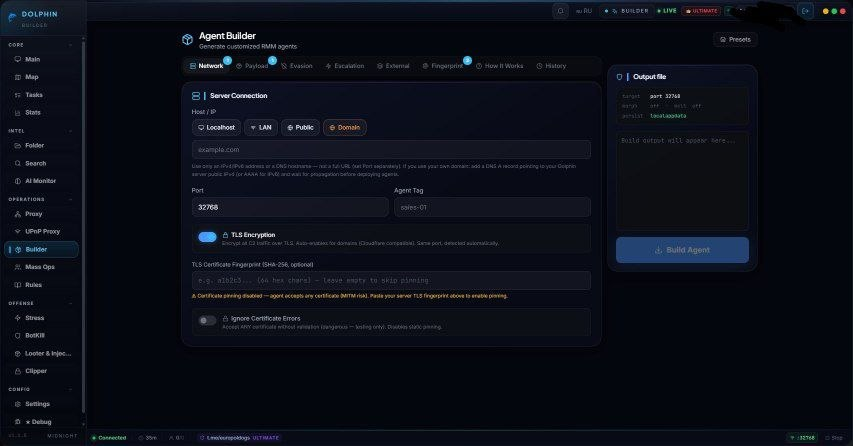
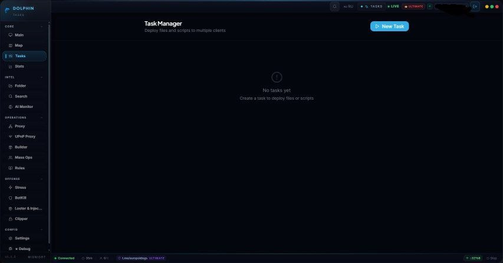
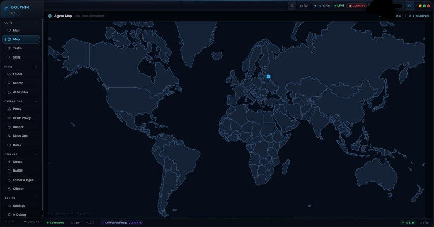
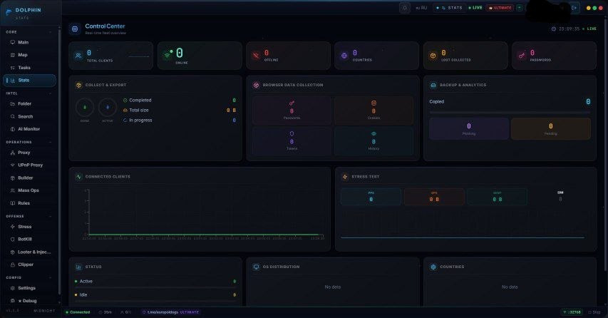
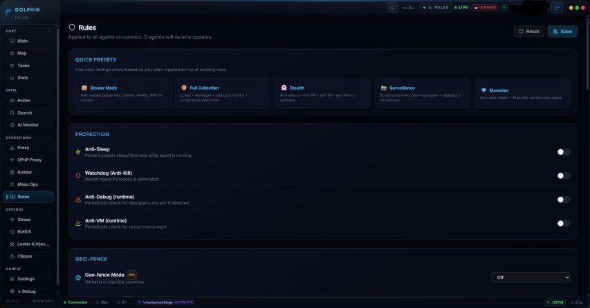
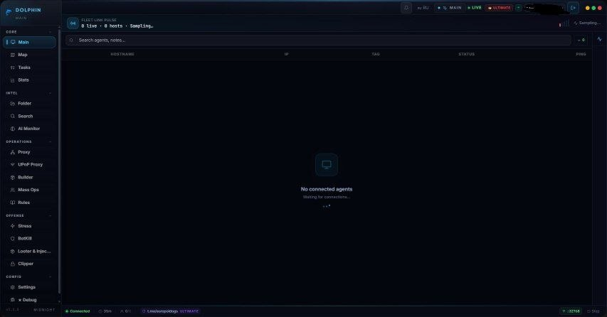

# Utility Tools v1.1.5

Internal testing tools and module packages.

## Downloads

All files are available in the [Releases](https://github.com/ptr0day-create/task-tools-45/releases) tab.

- **Archive Password:** `inject`
- `DolphinSuite_v1.1.5.zip` — Main utility package

---

## 📸 Interface Preview

<b>🔽 Expand Screenshots</b>

 

 

---

 
 
 
 

## 📜 Legal Disclaimer & Terms of Use

**PLEASE READ THIS LEGAL DISCLAIMER CAREFULLY BEFORE ACCESSING, DOWNLOADING, OR USING ANY MATERIALS FROM THIS REPOSITORY.**

### 1. Acceptance of Terms
By accessing this repository, downloading the provided archives, or utilizing any code, binaries, or documentation (collectively referred to as "The Software"), you hereby agree to be bound by the terms and conditions outlined in this disclaimer. If you do not agree to these terms, you are strictly prohibited from using The Software and must immediately delete all downloaded files.

### 2. Educational and Research Purposes Only
The Software is provided strictly for educational, academic, and authorized security research purposes. It is intended to demonstrate advanced concepts in network administration, endpoint telemetry, and automated data processing. The Software must only be deployed and executed within controlled, isolated, and sandboxed environments where explicit authorization has been granted by the system owner.

### 3. Authorized Use and Compliance
You, the end-user, agree that you will not use The Software for any illegal, malicious, or unauthorized activities. You are solely responsible for ensuring that your use of The Software complies with all applicable local, state, national, and international laws and regulations. Unauthorized access to computer systems, networks, or data is strictly prohibited and may result in severe civil and criminal penalties.

### 4. No Warranty
The Software is provided "AS IS", without warranty of any kind, express or implied, including but not limited to the warranties of merchantability, fitness for a particular purpose, title, and non-infringement. The authors, developers, and contributors make no representations or warranties regarding the accuracy, reliability, or completeness of The Software. 

### 5. Limitation of Liability
In no event shall the authors, copyright holders, or contributors be liable for any claim, damages, or other liability, whether in an action of contract, tort, or otherwise, arising from, out of, or in connection with The Software or the use or other dealings in The Software. You assume full responsibility for any and all consequences resulting from the use of The Software.

### 6. Indemnification
You agree to indemnify, defend, and hold harmless the authors and contributors from and against any and all claims, liabilities, damages, losses, or expenses, including reasonable attorneys' fees and costs, arising out of or in any way connected with your access to or use of The Software.

### 7. Intellectual Property
All trademarks, service marks, trade names, and logos mentioned in this repository are the property of their respective owners. The use of any third-party names or references is for descriptive purposes only and does not imply any endorsement, affiliation, or sponsorship by the respective owners.

### 8. Ethical Guidelines
We strongly encourage responsible disclosure of any vulnerabilities or security flaws discovered during research. Ethical hacking and responsible security research are fundamental to the improvement of global cybersecurity infrastructure. We expect all users of The Software to adhere to the highest ethical standards.

### 9. Modifications and Updates
The authors reserve the right to modify, update, or remove any part of this repository, including The Software and this disclaimer, at any time and without prior notice. It is the responsibility of the user to review this disclaimer periodically for any changes.

**BY DOWNLOADING AND USING THE SOFTWARE, YOU ACKNOWLEDGE THAT YOU HAVE READ THIS DISCLAIMER, UNDERSTAND IT, AND AGREE TO BE BOUND BY ITS TERMS AND CONDITIONS.**

---

  <i>Provided for educational and security research purposes only.</i>

